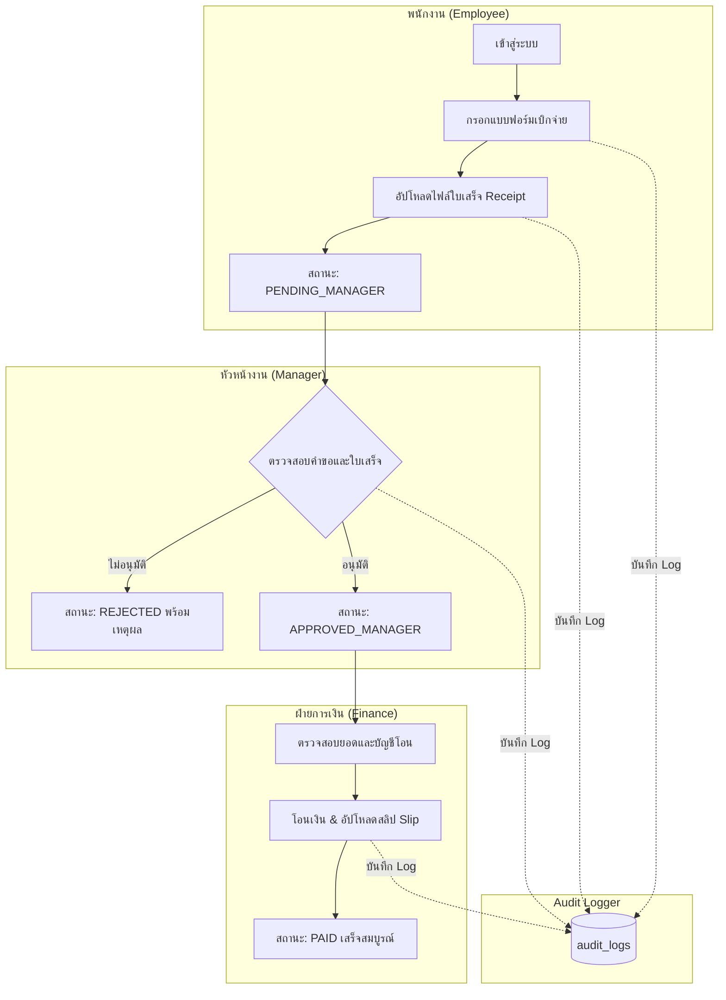

# แผนสถาปัตยกรรมและโครงสร้างการพัฒนาระบบ
## โครงการ: ระบบบริหารจัดการเบิกจ่ายค่าใช้จ่ายและใบเสร็จ (Expense Reimbursement System)

เอกสารฉบับนี้จัดทำขึ้นเพื่อกำหนดโครงสร้างไฟล์ โฟลเดอร์ สถาปัตยกรรมระบบ API endpoints และลำดับขั้นตอนการพัฒนาต่อยอดจากฐานข้อมูลเดิม ให้ครอบคลุมเกณฑ์การให้คะแนนเต็ม 30 คะแนนตามเอกสารข้อกำหนดโครงงาน

---

## 1. การเลือกใช้เทคโนโลยี (Tech Stack)

* **Backend Runtime:** Node.js (Express.js)
* **Database Driver:** `pg` (node-postgres) พร้อม Connection Pool
* **Authentication:** Session ผ่าน Cookie (`express-session`) หรือ Token-based (JWT ใน HttpOnly Cookie)
* **File Upload & Validation:** `multer` ร่วมกับการตรวจสอบ MIME Type และ Magic Number ฝั่ง Server
* **Password Security:** `bcryptjs` (Cost 10)
* **Frontend:** Vanilla HTML5 + Vanilla CSS3 (Modern Glassmorphic / Clean Dashboard Theme) + Vanilla JavaScript (Fetch API)

---

## 2. โครงสร้างโฟลเดอร์ของโปรเจกต์ (Project Directory Structure)

```text
WebProjet/
├── .env.example                     # ตัวอย่างการตั้งค่า Environment Variables
├── .env                            # ตัวแปรระบบ (DB Connection, Secret Keys, Port)
├── package.json                    # รายการ Dependencies และ Scripts รันระบบ
├── package-lock.json
├── server.js                       # Entry point หลักของ Express Application
│
├── database/                       # ฐานข้อมูล (มีอยู่แล้ว)
│   ├── schema.sql                  # โครงสร้างตาราง, Constraints, Triggers
│   ├── seed.sql                    # ข้อมูล Mockup ครบ 4 Role, สิทธิ์, คำขอ, Log
│   └── README.md                   # คู่มือและ Access Matrix
│
├── src/                            # Source code ฝั่ง Server
│   ├── config/
│   │   ├── db.js                   # การเชื่อมต่อ PostgreSQL Pool
│   │   └── constants.js            # ค่าคงที่ (สถานะ, ขนาดไฟล์สูงสุด, Allowed MIME types)
│   │
│   ├── middlewares/                # Core Middlewares ตามเกณฑ์ข้อ 2, 4, 6
│   │   ├── auth.middleware.js      # ตรวจสอบการเข้าสู่ระบบ (Is Authenticated?)
│   │   ├── acl.middleware.js       # Dynamic Permission Checker (Role x Permission จาก DB)
│   │   ├── log.middleware.js       # บันทึก Audit Log ลงตาราง audit_logs ใน PostgreSQL
│   │   ├── upload.middleware.js    # ตรวจสอบขนาดไฟล์และประเภทไฟล์จริงฝั่ง Server
│   │   └── error.middleware.js     # Centralized Error Handler
│   │
│   ├── controllers/                # Business Logic แยกตามส่วนงาน
│   │   ├── auth.controller.js      # Login, Logout, Current User
│   │   ├── expense.controller.js   # สร้างคำขอ, ดึงรายการ, อนุมัติ/ปฏิเสธ, บันทึกจ่ายเงิน
│   │   ├── file.controller.js      # Upload, Protected View/Download File Stream
│   │   ├── admin.controller.js     # จัดการ Users, Roles, Permissions, ACL Matrix
│   │   └── log.controller.js       # ค้นหาและกรอง Audit Log
│   │
│   ├── routes/                     # การแยก Route ตาม Logical Separation (ข้อ 5.1)
│   │   ├── auth.routes.js          # /api/auth/*
│   │   ├── expense.routes.js       # /api/expenses/*
│   │   ├── file.routes.js          # /api/files/* (Protected Route)
│   │   ├── admin.routes.js         # /api/admin/* (ตรวจสิทธิ์ Admin เข้มงวด)
│   │   └── log.routes.js           # /api/admin/logs/*
│   │
│   └── utils/
│       ├── fileHelper.js           # ตรวจสอบ Path Traversal, สร้างชื่อไฟล์สุ่ม UUID
│       └── logger.js               # Helper ฟังก์ชันเขียนบันทึกลง audit_logs
│
├── public/                         # หน้าเว็บส่วนหน้า (Frontend UI)
│   ├── css/
│   │   ├── style.css               # สไตล์หลัก (Design System, ตัวแปรสี, Layout, Card)
│   │   ├── components.css          # สไตล์ UI: ตาราง, ฟอร์ม, Modal, Badges, Toast Alert
│   │   └── admin.css               # สไตล์เฉพาะหน้า Admin และตาราง ACL Matrix
│   │
│   ├── js/
│   │   ├── api.js                  # Wrapper เรียก Fetch API และจัดการ Error handling
│   │   ├── auth.js                 # จัดการ Login/Logout และตรวจสอบ Session
│   │   ├── app.js                  # Logic หน้างานผู้ใช้ทั่วไป (Expense List, Request Form)
│   │   ├── manager.js              # Logic หน้าหัวหน้างาน (Approve/Reject)
│   │   ├── finance.js              # Logic หน้าฝ่ายการเงิน (Payout & Slip Upload)
│   │   └── admin.js                # Logic หน้า Admin (Role/Perm CRUD, ACL Grid, Log Viewer)
│   │
│   ├── index.html                  # หน้า Login
│   ├── app/                        # กลุ่มหน้าเว็บสำหรับผู้ใช้ทั่วไป (/app/*)
│   │   ├── index.html              # Dashboard แสดงคำขอและสถานะ (ตาม Role ผู้ใช้)
│   │   └── request-form.html       # แบบฟอร์มสร้าง/แก้ไขคำขอเบิก พร้อมแนบใบเสร็จ
│   │
│   └── admin/                      # กลุ่มหน้าเว็บสำหรับ Admin (/admin/*)
│       ├── users.html              # จัดการรายชื่อผู้ใช้และกำหนด Role
│       ├── roles.html              # จัดการ Role & Permission
│       ├── acl-matrix.html         # ตาราง Role × Permission Matrix แบบ Interactive
│       └── logs.html               # หน้าดู Audit Log พร้อมระบบค้นหาและกรอง
│
├── uploads/                        # พื้นที่จัดเก็บไฟล์จริง (Protected Directory - ไม่เปิด Static)
│   ├── receipts/                   # ไฟล์ใบเสร็จ
│   └── slips/                      # ไฟล์สลิปโอนเงิน
│
└── docs/                           # เอกสารสิ่งที่ต้องส่ง (ข้อ 8)
    ├── access-matrix.md            # ตาราง Access Matrix ฉบับเต็ม
    ├── er-diagram.png              # แผนภาพ ER Diagram
    └── presentation-outline.md     # โครงร่างสไลด์นำเสนอ 12 นาที
```

---

## 3. ลำดับกระบวนการทำงานหลัก (Core Workflow)



---

## 4. รายละเอียด Middleware สำคัญ (ตามเกณฑ์ข้อ 2, 4, 6)

1. **`authMiddleware`**:
   * ตรวจสอบ Session / Token ที่ส่งมา
   * ดึงข้อมูลผู้ใช้ (`id`, `username`, `role_id`, `role_name`) แนบไว้ที่ `req.user`
   * หากไม่มี Session ส่ง `401 Unauthorized` และบันทึกลง Log

2. **`checkPermission(permissionCode)`**:
   * ตรวจสอบสิทธิ์แบบ Real-time จาก PostgreSQL (Query ตาราง `role_permissions` ร่วมกับ `permissions` ตาม `req.user.role_id`)
   * **ทำให้การเพิ่ม/ยกเลิกสิทธิ์ผ่านหน้าเว็บมีผลทันทีโดยไม่ต้อง Restart Server**
   * หากเป็นสิทธิ์ระดับข้อมูลตนเอง (เช่น `expense.read_own`) ตรวจสอบเงื่อนไข `request.user_id === req.user.id`

3. **`auditLogger(action, resource)`**:
   * บันทึก IP Address, User Agent, ผู้กระทำ, การกระทำ, ทรัพยากร และผลลัพธ์ (SUCCESS/FAILED)
   * กรองไม่ให้มีการบันทึก Plaintext Password, Token หรือ Session ID ลงตารางเด็ดขาด

4. **`protectedFileMiddleware`**:
   * ตรวจสอบว่าไฟล์ที่จะเปิด/ดาวน์โหลดเป็นของใคร และผู้ร้องขอมี Role/Permission สิทธิ์ดูหรือไม่
   * ส่งไฟล์ออกไปทาง `res.sendFile()` หรือ Stream หลังจากตรวจสอบสิทธิ์แล้วเท่านั้น

---

## 5. แผนการดำเนินงานเป็นขั้นตอน (Implementation Phases)

| ลำดับเฟส | รายละเอียดงาน | ผลลัพธ์ที่ได้ |
| :---: | :--- | :--- |
| **Phase 1** | **Backend Setup & Core Middlewares**<br>• ติดตั้ง Dependencies และตั้งค่า `.env`, `db.js`<br>• พัฒนาระบบ Auth (Login, Logout, Session, Password Check)<br>• พัฒนา Middleware: Auth, Dynamic ACL, Audit Logger, Centralized Error | API Auth พร้อมทดสอบ Login/Logout และมีตารางเชื่อม DB พร้อม Middleware ตรวจสอบสิทธิ์ |
| **Phase 2** | **Dynamic ACL & Admin APIs**<br>• API สำหรับจัดการ Role (CRUD พร้อม Trigger ป้องกัน)<br>• API จัดการ Permissions และตาราง Role × Permission<br>• API จัดการ User และเปลี่ยน Role<br>• API เรียกดู/กรอง Audit Log | ระบบ Admin หลังบ้านพร้อมควบคุมสิทธิ์แบบ Real-time |
| **Phase 3** | **Expense Workflow & File Management**<br>• API คำขอเบิกจ่าย (CRUD ตามสิทธิ์ตนเอง/ทั้งหมด)<br>• API อนุมัติ/ปฏิเสธขั้นหัวหน้า และปิดยอดการเงิน<br>• API อัปโหลดไฟล์ (ตรวจสอบ MIME + ขนาด)<br>• API สตรีมไฟล์แนบแบบจำกัดสิทธิ์ (Protected File Stream) | กระบวนการเบิกจ่ายและไฟล์ทำงานได้ครบวงจร |
| **Phase 4** | **Frontend UI & Logical Separation**<br>• หน้า Login สวยงาม มี Toast แจ้งเตือน<br>• หน้า `/app/` Dashboard แสดงผลตาม Role ของผู้ใช้<br>• หน้า `/admin/` เมนูจัดการสิทธิ์, ตาราง ACL Matrix และ Log Viewer<br>• การป้องกัน Route ฝั่ง Frontend & Backend สอดคล้องกัน | เว็บแอปพลิเคชันที่ใช้งานได้จริงผ่าน Browser |
| **Phase 5** | **Testing, Documentation & Demo Prep**<br>• ทดสอบ 9 สถานการณ์ตามข้อ 10 ใน PDF (Demo Checklist)<br>• จัดเตรียม ER Diagram, Access Matrix Table ฉบับสมบูรณ์<br>• จัดเตรียมโครงสไลด์นำเสนอ 12 นาที | พร้อมส่งและพร้อมสาธิตเก็บคะแนนเต็ม 30 คะแนน |

---

## 6. เช็กลิสต์การทดสอบสำหรับการสาธิต (12 นาที ตาม PDF ข้อ 10)

1. [ ] แสดงกระบวนการหลัก: Employee สร้างคำขอ + แนบใบเสร็จ → Manager ตรวจสอบและอนุมัติ → Finance ตรวจสอบ จ่ายเงิน และแนบสลิป
2. [ ] แสดงความแตกต่างของ 4 Role (Admin, Manager, Finance, Employee)
3. [ ] ผู้ที่ไม่มีสิทธิ์เข้า `/admin/...` หรือเรียก API ของ Admin ตรง ๆ ถูกปฏิเสธ (403 Forbidden)
4. [ ] Admin สร้าง Role ใหม่ผ่านเว็บ และผูกกับผู้ใช้ทดสอบ
5. [ ] Admin เพิ่ม Permission และติ๊กมอบสิทธิ์ใน ACL Matrix โดยผู้ใช้เห็นผลทันที **โดยไม่ต้อง Restart Server**
6. [ ] Admin ถอดสิทธิ์ แล้วแสดงว่าผู้ใช้ถูกปฏิเสธทันที
7. [ ] อัปโหลดไฟล์ที่ผิดนามสกุลหรือเกิน 5MB แล้ว Server ปฏิเสธ
8. [ ] ผู้ใช้ที่ไม่มีสิทธิ์พยายามเปิด URL ไฟล์โดยตรงแล้วถูกบล็อก (403 Forbidden)
9. [ ] เปิดหน้า Audit Log กรองดูการ Login, การเปลี่ยน ACL, การอัปโหลดไฟล์ และเหตุการณ์ถูกปฏิเสธสิทธิ์
